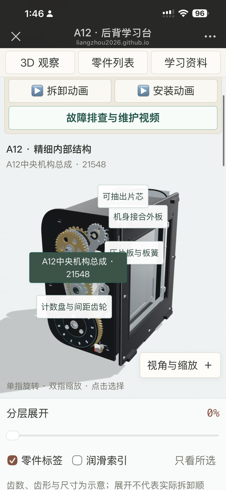

# Hasselblad Film Magazine Learning

[中文说明](README.md) · [MIT license](LICENSE) · [Third-party notices](THIRD_PARTY_NOTICES.md)

**A free Chinese/English 3D learning tool: explore 16 Hasselblad film magazines in your browser, with A12 / A16 / A24 disassembly and assembly demos.**

[Try the English demo](https://liangzhou2026.github.io/hasselblad-film-magazine-learning/?lang=en) · [打开中文演示](https://liangzhou2026.github.io/hasselblad-film-magazine-learning/?lang=zh)

<p align="center">
  <a href="https://liangzhou2026.github.io/hasselblad-film-magazine-learning/?model=A12&amp;lang=en">
    
  </a>
</p>
<p align="center"><em>Actual A12 mobile interface, shown in Chinese.</em></p>

## Start in three steps

1. [Open the demo](https://liangzhou2026.github.io/hasselblad-film-magazine-learning/?model=A12&lang=en) and select A12.
2. Rotate the model and select a part to read its name and description. On phones, drag with one finger and pinch with two to zoom.
3. Play the disassembly demo to explore how the parts relate, or switch to the assembly demo.

**Educational approximations, not repair instructions.** This independent community project is not factory CAD. Animated movement does not validate real-world removal paths.

[Feedback welcome](https://github.com/liangzhou2026/hasselblad-film-magazine-learning/issues). Star the repository if you find it useful.

[Complete source with manuals](https://github.com/liangzhou2026/hasselblad-film-magazine-learning/releases/tag/v1.0.2) · [Optional model downloads](https://github.com/liangzhou2026/hasselblad-film-magazine-learning/releases/tag/v1.0.0)

## What you can explore

- **A12, A16, A24:** selectable parts, 22-step disassembly and 26-stage assembly demonstrations, with rotation and zoom during playback, and lubrication references.
- **13 additional models:** A16S, A32, A12TCC, A16TCC, A24TCC, E12, E16, E24, E12CC, Magazine 70, Polaroid 100, PolaPlus and PolaBasic. These offer free exploration and exploded views only, with names limited to documented parts.
- Shared model selector, part visibility controls, bilingual descriptions, manual page references and links to maintenance videos.

## Language

Select **English** or **中文** in the page header. The interface, part names and descriptions, service sequences, care notes and video descriptions change without reloading the model or restarting playback. The browser remembers your choice; share a URL with `lang=en` or `lang=zh` to specify a language.

Search accepts English and Chinese names and original part numbers. Translation preserves source data, numeric values and manual page references. Original PDFs, YouTube videos and optional GLB/JSON attachments retain their original content. “Film insert” and “film holder” both refer to the removable insert.

## Run locally

Phones use a model-first single-column layout with the model selector at the top and shortcuts to the viewer, parts and references. Tablets adapt their columns to portrait or landscape. Small screens have collapsible view controls and larger touch targets. Models support one-finger rotation and two-finger pinch zoom; original manuals can be read page by page.

Use Node.js 22+ and a modern WebGL browser. No npm install is needed.

```sh
node scripts/check-release.mjs
node --expose-gc scripts/check-i18n.cjs
node scripts/serve.mjs
```

Open the local URL printed by the server. The `/learning/` prefix tests project-site relative paths. Use `node scripts/serve.mjs 8934` if the default port is occupied.

The localization check constructs all 16 models and checks final displayed metadata, numeric identifiers, dynamic translations, language roundtrips and input preservation. It uses a DOM test double and does not replace browser/WebGL checks.

The site constructs its models from JavaScript. No GLB downloads are needed to view it. It includes the 66-page film magazine service manual, the 23-page user manual and a 193-page Service Infos / S7 bulletin compilation, with source notes. The PDFs retain their original bytes. All 282 page images load on demand for mobile reading and part/sequence references. Source links and session-only local PDF selection remain available. Collected reference photographs are excluded. External source links, YouTube and Release downloads require Internet access. No installable offline cache is provided.

The release check allows only PDFs and page images declared in `site/manuals/manifest.json`, verifying file size, SHA256, format and paths. Undeclared manuals, photographs and research attachments remain excluded.

## Deploy your own copy

Upload this directory's contents as the repository root, including `.github`. Select **GitHub Actions** as the Pages source in repository settings. The provided workflow deploys only `site/` on pushes to `main` or manual dispatch. Check the workflow result and deployed site, and update the README demo links plus the canonical, Open Graph and Twitter image URLs in `site/index.html` to your own Pages address.

Optional generated GLB files and part lists are available in **[GitHub Releases](https://github.com/liangzhou2026/hasselblad-film-magazine-learning/releases/tag/v1.0.0)**, outside the source repository. To host your own downloads, upload each of the 13 `.glb` and 13 `.parts.json` files individually to release `v1.0.0`, then set `repository: 'owner/repository'` in `site/release-config.js`. An empty configuration disables downloads with an explanation. Uploading only a ZIP will not provide the individual download URLs.

GLB exports do not include browser animations, Canvas labels or scene lighting. The original three models run from source and currently have no standalone GLB downloads. Preserve model root transforms when importing.

## License and contributions

Original code, project-authored documentation and generated teaching geometry use MIT. Three.js keeps its own MIT notice. The three included manuals and their page images retain their original rights and notices; they are provided for repair learning and are not licensed under MIT. The service manual is sourced from Galerie-photo and the user manual from Butkus. The maintainer supplied the 193-page bulletin compilation; its original public download URL has not been verified. Public availability does not make a work public domain. Collected photographs and video copies remain excluded. See [THIRD_PARTY_NOTICES.md](THIRD_PARTY_NOTICES.md).

Contributions should cite a manual edition/page or another verifiable source and distinguish measured dimensions from approximations. See [CONTRIBUTING.md](CONTRIBUTING.md). Static checks do not establish mechanical, electrical, calibration or photographic correctness.
